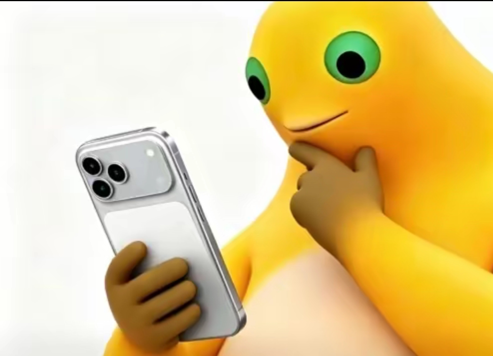

转眼踏入大学生活已经有两个月之久了，大学生活相比高中生活也确实轻松了很多，最直观的一点就是可以一直拿着手机，起初我认为可能还是会有一点限制的，比如上课不能玩之类的，但现在来看真的是全靠自己的自觉（起码上课一直不听课，老师不会像高中一样一直盯着你），可能因为北信科的氛围还是相对比较轻松的，把时间几乎都交由给我们，但是休闲的时间多了，直观来看是好的，但是不好的地方肯定也是有的（这里说不好的不太精确），下面先讲好的地方再说不好的地方。（这里可支配时间主要是指无课时间再加上某一些课的时间都算在里面了)

对于刚从高三高压环境解放的学生来说，轻松最直观的一点就是可以休息的时间变多了，一天你想睡多久都可以，这无论是对学生的个人健康和未来学习都是有益的。可支配的时间变多，你也可以去参加各种各样的活动，比如辩论赛，表演节目，参加社团，加入学生组织等，在这一点，北信科这个平台完全是够的，起码想把个人是时间占满是很简单的，如果你有你感兴趣的方向，你应该在这两个月的时间已经参与了几次活动，并决定你之后要不要持续深耕。第三，时间变多你可以自己感兴趣的知识，比如喜欢编程的同学可以学习python，这里我觉得北信科开设的新生研讨课还是有一定意义的，起码你可以选择你感兴趣的方向了解一下，虽然架不住那知识太难了，对于一个大一学生来讲完全听不懂，但确实让我有了一定的兴趣，我觉得可能这也就是这个课的意义了，这个新生研讨课的形式很好，但具体我觉得还是可以优化一下。第四，你可以花更多的时间在人际关系上，我个人还是很喜欢交新朋友的，大学生活让我认识了很多很优秀的人，但是大学生活大家还是以个人为重的，都有自己的事情要做，大多数人也只能停留在点头之交，但能让我认识几个不同类的优秀的人，让我能有机会聊两句天也已经很好了。还有这个完全学分制，每个人的课表几乎也都不一样，所以所谓熟络新朋友的机会也是变少了，但也无疑是又加强了每个人的独立做事的能力，我认为站在学生的角度很难说是好是坏，交给以后的我来评判的。当然这里说的花时间在人际关系上也不只是认识陌生人，和自己的高中同学老朋友在宿舍打三国杀，玩王者荣耀也是相当惬意的。最后，我个人的认为大学生活的还有一点很大的好处就是每天都可以穿自己想穿的衣服，不用一周五天都穿校服了，我每天的心情就开心的了很多，虽然我们高中的校服还是相当好看的，但是五天都穿一样的未免还是有点疲倦。这里我总结的好处大概就这几点，下面的的不好才是我现在的主要心态。

什么事情都是一把双刃剑，有好就有不好，可支配的时间变多，休闲的背后也会有迷茫。我上了大学我的主旋律应该是什么呢？也就是我剩的时间都干什么，这个问题我还不能很好的解决，但我可以先一个个排除，前面我已经列出了很多道路，首先是参加社团这件事情，我个人没有想加入很多社团，害怕以后可支配的时间会变少，没有时间去忙关于就业与升学的事情，但是我也不想我的大学只干这些所谓的正事，所以我还是挑了我感兴趣的事情去做的。（当然这也多虑了，我怎么可能是每天都在干正事的人呢）接下来就是学习自己感兴趣的东西，当然这个东西还是要对我的未来有点用的，完全没用的东西应该也不会有人感兴趣。这里包括一些爱好技能比如唱歌，乐器，画画，剪辑，下棋，运动等，学这些东西最好的时间就是在十年前，可惜我没有抓住这个机会，什么都没有学会。其次就是现在了，大学四年理论上还是有充足时间去学习这个技能的，这些技能的重要性感觉也不会比就业技能要差，毕竟可能会成为你一生的爱好，在踏入社会后如果有了休闲时间，你也会想起这些你培养的爱好用来陶冶情操。当然玩手机，旅游这种爱好不算，因为这些爱好好像不需要培养就能会。

<figure class="figure--full" data-media-id="b0286449-c898-450c-bc72-c099f33a0a90" style="width: 21%;"><figcaption>正在玩手机的奶娃</figcaption></figure>

接下来就是专业型技能，简单来说就是你以后想入哪个行当，当然这是所有大学生都要考虑的问题，我也在考虑这个问题，每个人都会考虑很多方面来决定自己未来的就业方向，自己的兴趣，行业景气度（薪资水平），学习难度，家庭支持（这里举例如果你爱好是金融，但是你考研的时候发现学费也太高了，如果家庭支持不了那就只能放弃，所以对决定是否学金融这几乎是决定性因素。或者家长十分反对你学这个专业，对你个人进行学习造成了阻力，但我家长十分尊重我的意见，且还在负担我大学的学费，我应该感谢他们，所以接下来我的家庭因素占比会很低。）这里我建议每个人都可用层析分析法求一下每个因素的权重，我先构造一个针对我自己的判断矩阵（一切从简，因为复杂一点我也不会）

| 兴趣 | 薪资 | 难度 | 家庭 | | --- | --- | --- | --- | --- | | 兴趣 | 1 | 1/2 | 4 | 8 | | 薪资 | 2 | 1 | 8 | 9 | | 难度 | 1/4 | 1/8 | 1 | 2 | | 家庭 | 1/8 | 1/9 | 1/2 | 1 |

这样针对这四个因素对我择业的影响就能计算出来了（豆包算的），薪资=0.735，兴趣=0.245，难度=0.015，家庭=0.005。由此可见薪资对我择业的影响最大，其次是兴趣，难度和家庭影响较小。但这只能代表我的主观看法，因为这些数据也都是我主观感觉出来的，从这个数据可以看到，我本人是一个相当乐观，喜欢搏上线的人，虽然这么看学习难度对我的择业影响较低，但是真碰到难的不行的问题时，我该跑还是会跑的哦，我还是很畏难的。

接下来先从我现在的专业说起信息与计算科学说起，因为我决定我对什么感兴趣也是先依托我的这个专业来的，被录到这个专业之前我根本没有听说过这个专业，于是在得知了我被调剂到这个专业之后，我立即开始在网上搜集有关于这个专业的信息，发展方向等等，最开始看到的是各种给这个专业唱衰，说这个专业本质上就是数学专业，出来很难就业，什么只有985211的院校这个专业才可学这类说法，一开始看到这种说法，那我心里肯定还是很害怕的，怕自己大学四年学完结果毕业即失业，但是再多看看那其实搜每个专业都有大量的声音在唱衰，那我心里也就平缓很多了。其实网络上这么多唱衰的声音我们还是要理性看待的，固然可能有人故意传播焦虑，也有人是大学四年不学习，没有本事，只拿到毕业证，结果网络上大骂大环境不好的人的，但也有真实的就业竞争变强，岗位变少的客观原因存在的，那我一个人又能改变什么呢，只能尽量的不虚度大学四年的时光，少让自己被外界的环境所影响，提高自己的竞争力这唯一的解法。所以再回到对这个专业的看法与规划，刚才说的是一些不理性的看法，但其实也有认真分析这个专业的视频的：

<iframe src="https://player.bilibili.com/player.html?bvid=BV1kTp962Enj&amp;page=1&amp;autoplay=0" title="Bilibili 视频" allowfullscreen=""></iframe>

这个视频我觉得讲的就非常好，我觉得各个专业的人都可以找这个博主对应的视频，来启发一下对未来职业规划发展的思路，这里我就先说对信计这个专业我个人的规划思路，首先这个专业是计算机与数学的交叉专业，但是专业代码是数学，计算机只是工具（更准确一点应该说是编程吧，但其实这句话是废话，编程本来就是工具，以后编程已经不能作为一个专业技能了而是想打字或做ppt一样的基本素质，以后我觉得用ai工具应该也会是，甚至是开发自己的agent也会是，但这个应该会比较久吧。）在这个视频里博主提到了这个专业发展的六个方向，我挑几个我感兴趣的说一下首先是软件开发，这是我首先不考虑的一个方向，首先是我觉得这个方向没有什么前景了ai工具的发展已经把软件开发的门槛打到地板了，理论上一个掌握一门语言的人类都可以开发一个应用，所付出的成本也仅仅是给你的ai工具充钱，但是我对这个方向还是感兴趣的，以后我也想尝试用ai开发一个自己的app，但是我实在不想把这作为我的就业方向（不是说计科和软工这种专业不行，而是这个方向）然后是数据分析这个方向，感觉这个方向是可行性比较高的一个方向，门槛没有那么高，也不是很容易被ai取代，ai只能进行数据分析，但不能精准的做出预测和导向，如果有机会的话，我想去找相关的实习工作去尝试一下。第三个方向也就是我最感兴趣的ai与算法方向，因为我自己每天天天都在用ai工具，包括这个个人博客也是ai给我做的，包括我本人其实就是一个电脑盲，一开始连怎么卸载软件都不知道，但是现在我只需要跟ai说一句话，他就直接帮我卸载掉了，可以说我是一个婴儿，而ai就是一个保姆，感觉我要用电脑就离不开ai，所以我更想弄清楚ai背后的原理到底是什么，上了大学我知道了ai的本质其实就是数学，正好这个专业是数学专业，所以我就想就留在这个专业吧，虽然我们学校实行的完全学分制，转专业的难度小了很多，可以转到所谓录取分更高的好专业，但我秉持着随遇而安的准则，所以大学四年应该也是不会转专业了，正好也有我感兴趣想发展的方向，但是我也看网上说了人工智能算法岗的门槛很高，往往需要985211的学历，但是上文我也分析了我自己，对于择业，兴趣的权重是远远高于难度的权重，所以就先粗略的这么决定了，以后要真学不下去了再说嘛，我也是一个走一步看一步，很焦虑但是懒于行动的人。接下来就是研究岗，这个感觉不在我一个不知道研究需要做什么东西的大一学生去考虑，而且我真的能对研究知识这么感兴趣吗，我觉得我不是一个这样的人。最后就是考公务员进体制内，这是我最不想考虑的方向，去学校当老师，或者考公务员当平平淡淡的做重复的工作，但如果我真的找不到上面的工作我肯定还是要考虑的，毕竟还是要去挣钱的（这么说也不太合适，考公进体制内，靠编制竞争也很大，我也未必能成功。）上面其实都可以说是我看完这个视频之后的观后感，接下来我也会说说我自己的理解，首先信计这个交叉学科专业历史其实很久，我理解为研究生方向计算数学下放在本科的一个专业（或者说就是一样的，信计专业的前身就叫计算数学，所以信计最对口的研究生专业就是计算数学）所以说他不像现在因为企业流行而高校新增设的交叉专业（比如很多本科院校开设的人工智能专业其实就是计算机专业。）所以他是有一定的成功历史案例可以借鉴的，以前人能走通的路我们要相信自己也能走通。再附加一点就是每个学校的信计专业课程都有一定的偏向，有很多985211高校这个专业还是偏数学专业的，而我们学校还是一个偏应用型的高校的，在信计专业的培养方案我们完全可以学到计算机的408四门课还有离散数学，但其他偏研究型的院校就几乎全是数学课程，相反数学专业的课就会少学很多，不知道这对我们北信科专业的同学是好是坏，这对每个人来说答案都不一样，有人可能会想我要想学计算机我直接转到计算机不就行了，我要想学数学我直接转到数学专业不就行了（我们学校本科阶段没有数学专业，所以要对于想学数学专业的人留在这个专业好像还是个好事，不过想学数学的人应该还是少数。）我留在这个专业干什么呢，这也就是交叉学科的尴尬之处，你选的方向变多了，但是你针对一个方向的精度变差了，但我觉得这也是各大高校开那么多交叉专业的原因，其实本科阶段研究的方向都没那么精，交叉学科可以让你选的方向变多，而且有很多研究的方向它就是需要交叉学科的人才，你也有自己的一份独特性。所以我反倒认为这是一件好事，对于目标坚定的人在什么专业都无所谓，他都会在他选择的方向深耕。

上一段讨论了这么多关于方向选择的问题，我已经决定我想从事ai相关的工作，下面才是真正的入门，就是开始学习相关知识，那对我来说开始行动可是一件太难的事情，光是我要学的东西我都背不全，起码你的编程语言得会c++，python（mat numpy pandas pytorch各种各样的库），基本的工具git，linux系统，机器学习，深度学习。要想学习这些还必须依托我们现在在学的线性代数，c语言等知识打好基础，当然光盯着这么多东西发愁肯定是不行的，只有先学习这些知识才知道你未来该走的道路是否适合你，否则你就只能在原地踏步连选择权都没有。当然这是理想情况下，我会两耳不闻窗外事开始行动，知道自己要学这么多东西之后你才可能入门，并且入门之后你发现还是有一批更厉害的人已经熟练掌握了这些知识，这真的很让人发愁。下一步就是在网上找对应的资源去学习这些课程，你会发现网上针对一个知识点的不同课程多到数不清，你应该挑哪个课程下手又是个问题，于是又只能看网络上对每个课程的评价，和自己在b站大学里探索，你真的能发现确实有一部分有良心的博主，免费的给我们提供一些高质量的课程，但是也是真是有黑心的做视频只是为了博取流量卖课，说的就是b站那种贴各种名牌大学或者互联网大厂的logo的视频，给我们挑选课程增加难度，我是一个比较完美主义的人不挑到那种质量很高的口碑很好的课程我就很难看下去（不知道哪里养成的坏毛病，导致我的行动力特别差，还拖延），但好在我还是挑到了我能看下去的课程[https://liaoxuefeng.com/index.html](https://liaoxuefeng.com/index.html)，是的，这不是一个视频课程，是一位知名软件工程师的博客叫廖雪峰，真的是程序员里的六边形战士，精通各种计算机语言，而且他写的python教程面向纯小白，知识都翻译成了大白话讲给你，看他的知乎也能看到他经常回复一些有意思的问题，果然学识渊博的人同时也都是幽默的人。还有我喜欢这门课程的原因就是博客这种形式，可以让我各个时间都很方便的观看，要是上课的时候戴着耳机看视频课程显然很不尊重老师，看博客就完全避免了这点，随时随地都可以看，耳朵或许还能听到老师讲课（但是还是不建议一心二用，挑一件你认为有意义的事情去干就好了咳咳咳）目前其他课程我也没有开始看，所以我也没资格给出建议，以后我要看了肯定也会记录在博客里的，这期博客就先结束了。
